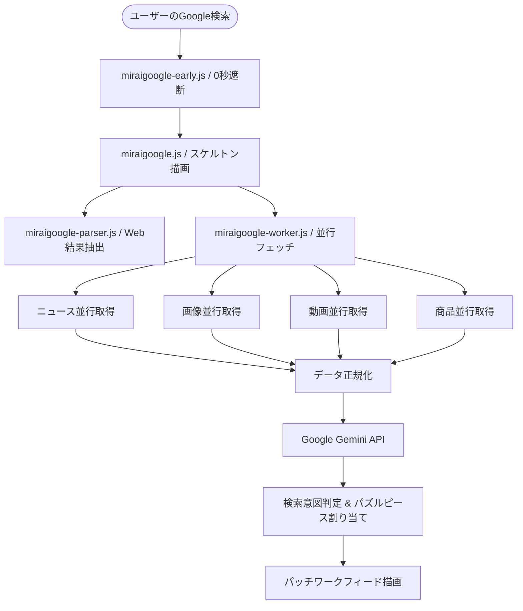

# miraigoogle 🧩

<p align="center">
  
</p>

<p align="center">
  <strong>Google検索の境界をなくし、Gemini AIでパッチワーク・パズル統合するChrome拡張機能</strong>
</p>

<p align="center">
  <a href="#license"></a>
  
  
</p>

---

## 📖 概要 (Overview)

**miraigoogle** は、Google検索における「ウェブ」「ニュース」「画像」「動画」「ショッピング」の縦割りカテゴリを排除し、検索意図に対して最適なフォーマットの情報を Gemini AI が自動判定して**雑誌のコラージュやパズルのように美しく敷き詰めた統合フィード（Bento Grid）**としてシームレスに表示するオープンソースの Chrome 拡張機能（Manifest V3）です。

---

## ✨ 主な特徴 (Key Features)

* 🧩 **パッチワーク / パズルレイアウト (Bento Grid):**
  均一なグリッドではなく、横長スプリット（ニュース・Web記事）、縦長ピン（縦構図写真・商品）、特大スクエア（注目動画・Hero画像）など、テトリスのようにカチッと噛み合う多面ピース構造。
* 🔀 **スマート・インターリーブ（分散ブレンド）:**
  Webばかり、ニュースばかりと固まることなく、検索意図（ニュース速報、商品比較、視覚調査、総合リサーチ）に合わせて各カテゴリが心地よく入り交じります。
* ⚡ **下からスーッと立ち上がるスタッガーアニメーション:**
  iOS/Material Design品質の上質なイージング（`cubic-bezier(0.16, 1, 0.3, 1)`）で、波のように連続して下からブロックが浮き上がります。
* 🖼️ **鮮明な高解像度プレビュー:**
  文字が潰れる画面縮小スクショを廃止し、本物の高画質OGP写真とモダンなブランドカバーを採用。
* 🔄 **ワンクリックで純正Google検索に復帰（リロード不要）:**
  画面右下のフローティングトグルをOFFにすれば、0ミリ秒で1ミリの崩れもなくGoogle純正の検索画面へ戻せます。
* 🎯 **「すべて」タブ限定発動:**
  ユーザーが画像タブや動画タブを明示的に開いた時は自動的にGoogle本来の特化タブを尊重し、干渉しません。

---

## 🛠️ システム構成 (Architecture)



---

## 🚀 インストール & 開発手順 (Getting Started)

### 1. リポジトリをクローン
```bash
git clone https://github.com/<YOUR_USERNAME>/miraigoogle.git
cd miraigoogle
```

### 2. Chromeに開発版として読み込む
1. Google Chrome を開き、アドレスバーに `chrome://extensions/` と入力します。
2. 右上の **「デベロッパー モード」** をONにします。
3. 左上の **「パッケージ化されていない拡張機能を読み込む」** をクリックします。
4. クローンした `miraigoogle` フォルダを選択します。

### 3. Gemini APIキーの設定（任意）
1. 拡張機能のアイコンまたはオプション画面を開きます。
2. [Google AI Studio](https://aistudio.google.com/app/apikey) で取得したAPIキーを入力して保存します。
   *(※APIキーが未設定でも、内蔵ルールベースヒューリスティックにより自動統合フィードが動作します)*

---

## 🔒 セキュリティ & プライバシー (Security & Privacy)

* **リモートコード不使用:** すべてのスクリプトは拡張機能内にローカル同梱されており、外部スクリプトの動的読み込みは一切行いません。
* **ローカルストレージ保護:** APIキーはブラウザ内（`chrome.storage.sync`）にのみ安全に保存されます。
* **データ収集ゼロ:** ユーザーの検索履歴や個人情報を外部サーバーに送信・収集することはありません。

---

## 🤝 コントリビューション (Contributing)

バグ報告、新機能の提案、Pull Request を大歓迎しています！  
詳細は [CONTRIBUTING.md](CONTRIBUTING.md) をご覧ください。

---

## 📄 ライセンス (License)

本プロジェクトは [MIT License](LICENSE) のもとで公開されています。
